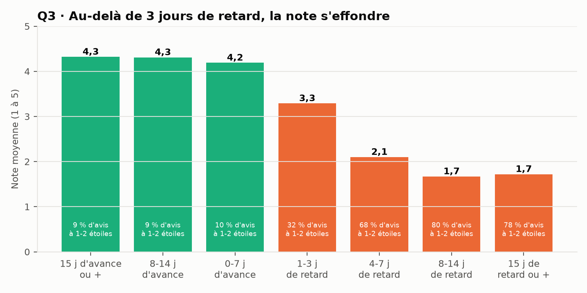
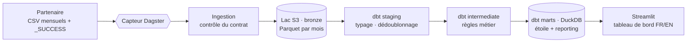

# 🛒 Faut-il vendre sur les marketplaces brésiliennes ? Une modern data stack locale sur 100 000 commandes réelles

🇬🇧 [English version](README.md) · 🇫🇷 **Français**

[](https://github.com/MediJr/olist-ecommerce-modern-data-stack/actions/workflows/ci.yml)


> Une **modern data stack qui tient sur un ordinateur portable** : des livraisons CSV mensuelles arrivent dans un **data lake S3**
> (Parquet), sont modélisées et testées avec **dbt** sur **DuckDB**, orchestrées par **Dagster** (capteurs, partitions dynamiques,
> rejeux), servies à un tableau de bord **Streamlit** bilingue, et protégées par une **intégration continue GitHub Actions**.
> Tout démarre avec un seul `docker compose up`.

> 🎭 **Scénario fictif, données réelles.** Le client, la marque de linge de maison *Maison Caju*, est inventé pour simuler une
> mission complète. Les données sont le **Brazilian E-Commerce Public Dataset by Olist** (Kaggle, CC BY-NC-SA 4.0).
> Ce projet n'est pas affilié à Olist.

## 📄 Rapports

| | |
|---|---|
| 🇫🇷 **Rapport d'ingénierie des données (PDF, 17 pages)** | [Rapport_Olist_Modern_Data_Stack_FR.pdf](docs/livraison/Rapport_Olist_Modern_Data_Stack_FR.pdf) |
| 🇬🇧 **Data engineering report (PDF, 17 pages)** | [Report_Olist_Modern_Data_Stack_EN.pdf](docs/livraison/Report_Olist_Modern_Data_Stack_EN.pdf) |

---

## 💼 Le contexte client

Maison Caju étudie le lancement de ses collections au **Brésil**, via les marketplaces locales. Avant d'engager un budget logistique,
son comité de direction veut des chiffres. Et son analyste doit pouvoir **faire évoluer les indicateurs seul, en SQL, sans rien casser**.

| # | Question business |
|---|---|
| **Q1** | Quelles **catégories** et quels **États** font le chiffre d'affaires, et comment évolue-t-il chaque mois ? |
| **Q2** | Les clients **reviennent**-ils acheter ? |
| **Q3** | Le **retard de livraison** dégrade-t-il la note client ? |
| **Q4** | Comment les clients **paient**-ils (carte, *boleto*, versements) ? |
| **Q5** | Combien pèse le **fret** selon l'État de destination ? |

## 📊 Résultats clés (commandes 2016-2018)

| # | Constat |
|---|---|
| **Q1** | 13,5 M BRL de CA sur 98 207 commandes valides. L'univers maison (linge, déco, équipement…) pèse **19,8 %** ; *bed_bath_table* est 3e. **SP, RJ et MG = 63 %**. Black Friday 2017 : **+52 %** par rapport à octobre. |
| **Q2** | Seulement **3,0 %** des clients commandent deux fois (28 jours plus tard en médiane) : ce marché se gagne par l'**acquisition**, pas par la fidélisation. |
| **Q3** | 6,8 % des commandes arrivent en retard. La note passe de **4,3 à 2,1** à partir de 4 jours de retard ; **68 à 80 %** des avis sont alors à 1-2 étoiles. |
| **Q4** | Carte bancaire **75,5 %**, *boleto* 19,9 %. Le panier grandit avec les versements : **101 BRL (1x) → 334 BRL (7-10x)**. |
| **Q5** | Le fret vaut **13,8 %** du prix des articles à São Paulo, **jusqu'à 28,5 %** dans le Nord (RR) et le Nord-Est (MA). |



## 🏗️ Architecture



| Service (`docker compose`) | Rôle | Adresse |
|---|---|---|
| `lake` | Stockage objet compatible S3 (SeaweedFS) | `127.0.0.1:8333` |
| `dagster` | Orchestration, ingestion, dbt | http://127.0.0.1:3000 |
| `dashboard` | Tableau de bord du comité (lecture seule) | http://127.0.0.1:8501 |

## 🛠️ Points forts côté data engineering

| Pratique | Mise en œuvre |
|---|---|
| **Contrat de livraison** | Le producteur écrit `_SUCCESS` en dernier ; en-tête (dérive de schéma), clés vides et en double vérifiés avant toute écriture dans le lac. |
| **Lac idempotent** | Un fichier Parquet par table et par mois (convention Hive `delivery_month=…`), **remplacé** au rejeu : aucun doublon possible. |
| **Orchestration par événements** | **Partitions dynamiques** Dagster (une par livraison reçue) et **capteurs** ; un mois relivré est détecté et rejoué. |
| **Couches dbt** | Staging (typage, la dernière livraison gagne) → intermediate (toutes les règles métier, écrites une fois) → marts (schéma en étoile + une table par question). |
| **Pièges des données réelles** | `customer_id` change à chaque commande (96 096 vrais clients) ; jointure articles × paiements qui multiplie le CA ; `review_id` non unique ; traductions manquantes. |
| **Des tests à chaque niveau** | 69 tests de données dbt, **3 tests unitaires dbt**, **rapprochements avec la source** (CA, paiements), un **contrat imposé**, 14 tests pytest. |
| **Une CI qui mord** | Ajouter le fret au CA fait échouer la construction deux fois : le contrat (type modifié) ou le rapprochement (même type). |
| **Concurrence** | DuckDB n'a qu'un écrivain : une exécution à la fois (limites Dagster), le tableau de bord ouvre l'entrepôt en lecture seule, à chaque requête. |
| **Incidents traités** | Image MinIO plus distribuée → SeaweedFS ; ordre d'amorçage ; Smart App Control (Windows) qui bloque des DLL non signées → plateforme entièrement dans Docker, délais maximaux d'exécution. |

## 🚀 Démarrage rapide

**Prérequis :** Docker Desktop, Git, un compte Kaggle (pour télécharger les données).

```bash
git clone https://github.com/MediJr/olist-ecommerce-modern-data-stack.git
cd olist-ecommerce-modern-data-stack
copy .env.example .env               # puis choisir S3_SECRET_KEY
```

1. Télécharger l'archive sur [Kaggle](https://www.kaggle.com/datasets/olistbr/brazilian-ecommerce) et l'enregistrer sous
   `data/source/olist-brazilian-ecommerce.zip`.
2. Démarrer la plateforme et simuler les livraisons du partenaire :

```bash
docker compose up -d --build
docker compose run --rm dagster python -m olist_pipeline.cli deliver --all
```

3. Suivre le traitement des 26 livraisons sur http://127.0.0.1:3000 (environ 20 minutes), puis ouvrir le tableau de bord sur
   http://127.0.0.1:8501.

## 📚 Documentation de la mission

| Étape | Document |
|---|---|
| 1. Demande | [Brief client](docs/mission/2026-10-23-01-brief-client.md) |
| 2. Cadrage | [Compte rendu](docs/mission/2026-10-23-02-compte-rendu-cadrage.md) |
| 3. Engagement | [Cahier des charges](docs/mission/2026-10-23-03-cahier-des-charges.md) |
| 4. Réalisation | [Journal de bord](docs/journal/2026-10-23.md) · [ADR](docs/decisions/) · [Dictionnaire de données](docs/dictionnaire-de-donnees.md) |
| 5. Recette | [Rapports (PDF)](docs/livraison/) · [PV de recette](docs/livraison/2026-10-25-pv-recette.md) · [Résultats chiffrés](docs/livraison/resultats.md) |

---

## 👤 Auteur

**Lumu Bamana Manasse**, data engineer en reconversion depuis la data analyse · GitHub : [@MediJr](https://github.com/MediJr)

**Niveau 3** d'un parcours de 7 projets. Niveaux précédents :
[0 · ETL Steam](https://github.com/MediJr/ubisoft-vs-ea-steam-etl) ·
[1 · Entrepôt OMS ODD 3](https://github.com/MediJr/who-sdg3-health-etl) ·
[2 · Pipeline incrémental du mix électrique](https://github.com/MediJr/france-power-mix-incremental-etl).

## 📄 Licence et données

Code sous licence [MIT](LICENSE). Données : **Brazilian E-Commerce Public Dataset by Olist**, Kaggle,
[CC BY-NC-SA 4.0](https://creativecommons.org/licenses/by-nc-sa/4.0/). L'archive complète n'est pas redistribuée ; l'échantillon de la CI
(`tests/fixtures/sample/`) est partagé sous la même licence.
