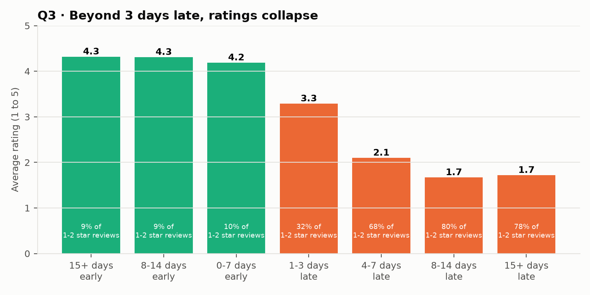
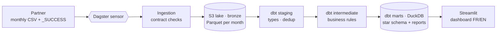

# 🛒 Should we sell on Brazilian marketplaces? A local modern data stack on 100,000 real orders

🇬🇧 **English** · 🇫🇷 [Version française](README.fr.md)

[](https://github.com/MediJr/olist-ecommerce-modern-data-stack/actions/workflows/ci.yml)


> A **modern data stack that runs on a laptop**: monthly CSV deliveries land in an **S3 data lake** (Parquet), are modelled and
> tested with **dbt** on **DuckDB**, orchestrated by **Dagster** (sensors, dynamic partitions, replays), served to a bilingual
> **Streamlit** dashboard, and protected by **GitHub Actions CI**. Everything starts with one `docker compose up`.

> 🎭 **Fictional scenario, real data.** The client, the French home-textile brand *Maison Caju*, is invented to simulate a complete
> engagement. The data is the **Brazilian E-Commerce Public Dataset by Olist** (Kaggle, CC BY-NC-SA 4.0). Not affiliated with Olist.

## 📄 Reports

| | |
|---|---|
| 🇬🇧 **Data engineering report (PDF, English, 17 pages)** | [Report_Olist_Modern_Data_Stack_EN.pdf](docs/livraison/Report_Olist_Modern_Data_Stack_EN.pdf) |
| 🇫🇷 **Rapport d'ingénierie des données (PDF, français, 17 pages)** | [Rapport_Olist_Modern_Data_Stack_FR.pdf](docs/livraison/Rapport_Olist_Modern_Data_Stack_FR.pdf) |

---

## 💼 Business context

Maison Caju is considering selling its collections in **Brazil** through local marketplaces. Before committing a logistics budget,
its board wants figures. And its analyst must be able to **evolve the metrics alone, in SQL, without breaking anything**.

| # | Business question |
|---|---|
| **Q1** | Which **categories** and **states** drive revenue, and how does it evolve month by month? |
| **Q2** | Do customers **come back**? |
| **Q3** | Does **late delivery** hurt the customer rating? |
| **Q4** | How do customers **pay** (card, *boleto*, instalments)? |
| **Q5** | How much does **freight** weigh, by destination state? |

## 📊 Key findings (orders 2016-2018)

| # | Finding |
|---|---|
| **Q1** | R$ 13.5 M revenue over 98,207 valid orders. Home categories (bed & bath, decor, housewares…) = **19.8 %**; *bed_bath_table* is #3. **SP, RJ and MG = 63 %**. Black Friday 2017: **+52 %** vs October. |
| **Q2** | Only **3.0 %** of customers ever order twice (median 28 days later): **acquisition, not loyalty**, drives this market. |
| **Q3** | 6.8 % of orders arrive late. Rating drops from **4.3 to 2.1** at 4-7 days late; **68 to 80 %** of late-week reviews are 1-2 stars. |
| **Q4** | Credit card **75.5 %**, *boleto* 19.9 %. Basket grows with instalments: **R$ 101 (1x) → R$ 334 (7-10x)**. |
| **Q5** | Freight = **13.8 %** of item price in SP, **up to 28.5 %** in the North (RR) and Northeast (MA). |



## 🏗️ Architecture



| Service (`docker compose`) | Role | URL |
|---|---|---|
| `lake` | S3-compatible object storage (SeaweedFS) | `127.0.0.1:8333` |
| `dagster` | Orchestration, ingestion, dbt | http://127.0.0.1:3000 |
| `dashboard` | Board dashboard (read-only on the warehouse) | http://127.0.0.1:8501 |

## 🛠️ Data engineering highlights

| Practice | Implementation |
|---|---|
| **Delivery contract** | Producer writes `_SUCCESS` last; header (schema drift), blank and duplicate keys checked before anything reaches the lake. |
| **Idempotent lake** | One Parquet file per table and month (Hive layout `delivery_month=…`), **replaced** on replay: no duplicates by design. |
| **Event-driven orchestration** | Dagster **dynamic partitions** (one per delivery received) and **sensors**; a re-delivered month is detected and replayed. |
| **dbt layers** | Staging (types, latest delivery wins) → intermediate (all business rules, written once) → marts (star schema + one report per question). |
| **Real data traps** | `customer_id` is per order (96,096 real customers); multi-item × multi-payment joins multiply revenue; non-unique `review_id`; missing translations. |
| **Tests at every level** | 69 dbt data tests, **3 dbt unit tests**, **reconciliation with the source** (revenue, payments), an **enforced contract**, 14 pytest tests. |
| **CI that bites** | Adding freight to revenue fails the build twice: the contract (type change) or the reconciliation (same type). |
| **Concurrency** | DuckDB has a single writer: one run at a time (Dagster tag limits), dashboard opens the warehouse read-only, per query. |
| **Incidents handled** | MinIO image no longer distributed → SeaweedFS; bootstrap ordering; Windows Smart App Control blocking unsigned DLLs → full Docker platform, run timeouts. |

## 🚀 Quick start

**Requirements:** Docker Desktop, Git, a Kaggle account (to download the data).

```bash
git clone https://github.com/MediJr/olist-ecommerce-modern-data-stack.git
cd olist-ecommerce-modern-data-stack
copy .env.example .env               # Windows (cp on macOS/Linux), then set S3_SECRET_KEY
```

1. Download the archive from [Kaggle](https://www.kaggle.com/datasets/olistbr/brazilian-ecommerce) and save it as
   `data/source/olist-brazilian-ecommerce.zip`.
2. Start the platform and simulate the partner's deliveries:

```bash
docker compose up -d --build
docker compose run --rm dagster python -m olist_pipeline.cli deliver --all
```

3. Watch Dagster process the 26 deliveries at http://127.0.0.1:3000 (about 20 minutes), then open the dashboard at
   http://127.0.0.1:8501.

Useful commands:

```bash
docker compose run --rm dagster pytest                                   # Python tests
docker compose run --rm dagster python -m olist_pipeline.dbt_cli build   # dbt models + tests
docker compose run --rm dagster python -m olist_pipeline.cli deliver --month 2017-02   # re-deliver one month
```

## 📁 Repository structure

```text
olist-ecommerce-modern-data-stack/
├── src/olist_pipeline/
│   ├── config.py        ← paths, lake location, delivery contracts
│   ├── landing.py       ← simulated monthly deliveries (_SUCCESS marker)
│   ├── bronze.py        ← contract checks, CSV → Parquet in the lake
│   ├── definitions.py   ← Dagster: assets, dynamic partitions, sensors, jobs
│   ├── dbt_cli.py       ← dbt launcher with the project environment
│   └── report.py        ← report charts (FR/EN) and figures
├── dbt/                 ← staging, intermediate, marts, tests, macros
├── dashboard/app.py     ← Streamlit dashboard (FR/EN)
├── tests/               ← pytest + CI sample (450 real orders)
├── dagster_home/        ← Dagster instance config (concurrency, run monitoring)
├── docs/                ← engagement (French), 6 ADRs, work log, data dictionary, reports, acceptance
├── Dockerfile · docker-compose.yml · .env.example · requirements.txt · pyproject.toml
└── .github/workflows/ci.yml
```

## ⚠️ Limitations

- 2016-2018 data: the conclusions describe the market's structure, not its current state.
- The dbt warehouse is fully rebuilt at each delivery (~20 s): fine at this volume, incremental models would be the next step.
- `dagster dev` runs webserver and daemon in one container with SQLite: right for a laptop, not for a production server.

## 📚 Engagement documents

| Step | Document |
|---|---|
| 1. Request | [Client brief](docs/mission/2026-10-23-01-brief-client.md) |
| 2. Scoping | [Meeting minutes](docs/mission/2026-10-23-02-compte-rendu-cadrage.md) |
| 3. Commitment | [Statement of work](docs/mission/2026-10-23-03-cahier-des-charges.md) |
| 4. Delivery | [Work log](docs/journal/2026-10-23.md) · [ADRs](docs/decisions/) · [Data dictionary](docs/dictionnaire-de-donnees.md) |
| 5. Acceptance | [Reports (PDF)](docs/livraison/) · [Acceptance sign-off](docs/livraison/2026-10-25-pv-recette.md) · [Figures](docs/livraison/resultats.md) |

*Engagement documents are written in French, as for a French client.*

---

## 👤 Author

**Lumu Bamana Manasse**, data engineer transitioning from data analytics · GitHub: [@MediJr](https://github.com/MediJr)

**Level 3** of a seven-project data engineering portfolio. Previous levels:
[0 · Steam ETL](https://github.com/MediJr/ubisoft-vs-ea-steam-etl) ·
[1 · WHO SDG 3 warehouse](https://github.com/MediJr/who-sdg3-health-etl) ·
[2 · Incremental power-mix pipeline](https://github.com/MediJr/france-power-mix-incremental-etl).

## 📄 License and data

Code released under the [MIT License](LICENSE). Data: **Brazilian E-Commerce Public Dataset by Olist**, Kaggle,
[CC BY-NC-SA 4.0](https://creativecommons.org/licenses/by-nc-sa/4.0/). The full archive is not redistributed; the CI sample in
`tests/fixtures/sample/` is shared under the same licence.
