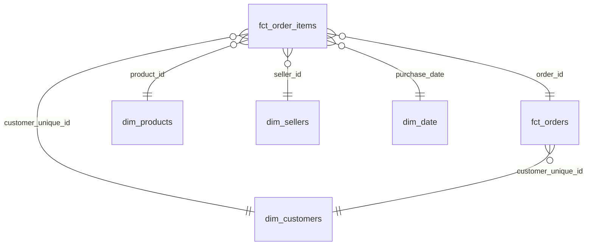

# Dictionnaire de données

> Version 1.0.0 · 2026-10-25. La documentation détaillée de chaque colonne est aussi générée par dbt :
> `docker compose run --rm dagster python -m olist_pipeline.dbt_cli docs generate`.

Montants en **réais (BRL)**, `decimal(12,2)`. Dates en **heure locale de Brasília**, sans fuseau (la source n'en donne pas).

## Vue d'ensemble

| Couche | Où | Contenu | Matérialisation |
|---|---|---|---|
| **Landing** | `data/landing/<AAAA-MM>/*.csv` + `_SUCCESS` | Livraisons du partenaire, telles que déposées | Fichiers CSV |
| **Bronze** | `s3://olist-lake/bronze/<table>/delivery_month=<AAAA-MM>/<table>.parquet` | Livraisons en Parquet, tout en texte, plus `_source_file` et `_ingested_at` | Fichiers Parquet (lac) |
| **Staging** | schéma `staging` | 1 vue par source : renommée, typée, dernière livraison retenue | Vues dbt |
| **Intermediate** | schéma `intermediate` | Règles métier | Vues dbt |
| **Marts** | schéma `marts` | Schéma en étoile et tables de reporting | Tables dbt |

## Marts : schéma en étoile

### `fct_order_items` · grain : un article vendu (112 650 lignes) · contrat imposé

| Colonne | Type | Description |
|---|---|---|
| `order_id`, `order_item_id` | varchar, integer | Clé composite |
| `customer_unique_id` | varchar | Client réel → `dim_customers` |
| `product_id`, `seller_id` | varchar | → `dim_products`, `dim_sellers` |
| `purchase_date`, `purchase_month` | date | Date d'achat → `dim_date` ; premier jour du mois |
| `customer_state` | varchar | État de livraison (au moment de la commande) |
| `order_status`, `is_valid` | varchar, boolean | Statut ; faux pour `canceled` et `unavailable` |
| `price`, `freight_value` | decimal(12,2) | Prix de l'article, fret |
| `revenue` | decimal(12,2) | **CA (définition D2)** : `price` si la commande est valide, sinon 0. Hors fret |

### `fct_orders` · grain : une commande (99 441 lignes)

| Colonne | Description |
|---|---|
| `order_id` | Clé |
| `customer_unique_id`, `customer_state` | Client réel et État |
| `is_valid`, `order_status` | Validité (D2) et statut |
| `customer_order_number` | Rang de la commande valide chez ce client (1 = première) ; vide si invalide |
| `item_count`, `items_value`, `freight_value` | Articles, somme des prix, somme du fret (agrégés **avant** jointure) |
| `payment_value`, `payment_count`, `main_payment_type`, `max_installments` | Paiements agrégés ; mode principal = celui du plus gros montant |
| `review_score`, `review_has_comment` | Dernier avis de la commande |
| `delivery_days` | Jours entre l'achat et la livraison (commandes livrées et datées) |
| `delay_days`, `is_late` | Jours de retard par rapport à la date promise (positif = en retard) |

### Dimensions

| Table | Grain | Colonnes principales |
|---|---|---|
| `dim_customers` (96 096) | client réel | `customer_state`, `customer_city`, `latitude`, `longitude` (adresse la plus récente) ; `valid_orders`, `first_order_at`, `cohort_month`, `second_order_at`, `days_to_second_order`, `is_repeat_customer` (≥ 2 commandes valides), `lifetime_revenue` |
| `dim_products` (32 951) | produit | `category_name_pt`, `category` (anglais, avec repli explicite ; `unknown` pour 610 produits), `has_official_translation`, poids et dimensions |
| `dim_sellers` (3 095) | vendeur | `seller_state`, `seller_city`, coordonnées |
| `dim_date` | jour | `year`, `quarter`, `month`, `month_start`, `year_month`, `iso_day_of_week`, `is_weekend` |

## Marts : tables de reporting (une par question)

| Table | Grain | Question |
|---|---|---|
| `rpt_revenue_monthly` | mois × catégorie × État | Q1 · CA, articles, commandes |
| `rpt_cohort_retention` | cohorte × mois écoulés | Q2 · `cohort_customers`, `active_customers`, `retention_rate` |
| `rpt_delivery_satisfaction` | tranche de retard | Q3 · `orders`, `avg_review_score`, `low_score_share` (part d'avis 1-2) |
| `rpt_payments` | mode principal × tranche de versements | Q4 · `orders`, `avg_order_value`, `total_paid` |
| `rpt_freight_by_state` | État | Q5 · `freight_to_price_ratio`, `avg_delivery_days`, `late_share`, `avg_review_score` |

## Intermediate

| Modèle | Rôle |
|---|---|
| `int_orders` | Une ligne par commande ; toutes les règles métier (validité, rang client, délai, retard). 3 tests unitaires dbt |
| `int_zip_code_locations` | Une position par préfixe de code postal : médiane des points, hors points situés hors du Brésil |

## Qualité : ce que vérifient les tests

| Type | Exemples | Nombre |
|---|---|---|
| Unicité et non-nullité | clés de chaque modèle, clés composites (`unique_combination`) | 69 tests de données au total |
| Relations | articles → commandes, produits, vendeurs ; faits → dimensions | |
| Valeurs acceptées | statuts, modes de paiement, notes 1 à 5, 27 États du Brésil | |
| Rapprochements avec la source | CA des marts = total bronze ; paiements des faits = total bronze ; cohorte complète au mois 0 | 3 tests singuliers |
| Tests unitaires | validité et retard ; non-multiplication des montants ; rang du client réel | 3 tests unitaires |
| Contrat | colonnes et types de `fct_order_items` | 1 contrat |
