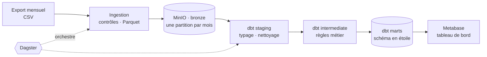

# 03 · Cahier des charges (Statement of Work)

> 🎭 **Scénario fictif** : voir le [brief client](2026-10-23-01-brief-client.md).

| | |
|---|---|
| **Référence** | CAJ-2026-001 |
| **Version** | 1.0 |
| **Date** | 2026-10-23 |
| **Client** | Maison Caju, représentée par Claire Dumont |
| **Prestataire** | Data engineer indépendant |
| **Statut** | ✅ Validé par le client (voir section 11) |

---

## 1. Contexte

Maison Caju étudie son lancement sur les marketplaces brésiliennes. Son comité de direction veut des réponses chiffrées sur le marché,
et son analyste doit pouvoir **faire évoluer les indicateurs seul, en SQL, sans risque de régression**.

## 2. Objectifs

1. Mettre en place une **modern data stack** locale et reproductible : data lake, entrepôt, transformations testées, orchestration, tableau de bord.
2. Traiter les livraisons **mensuelles** de données, un mois à la fois, de façon **rejouable**.
3. Construire un **schéma en étoile** documenté et testé, avec des définitions métier uniques (CA, client fidèle).
4. **Répondre** aux cinq questions business, dans un rapport et dans un tableau de bord.
5. Protéger le projet contre les régressions grâce à l'**intégration continue**.

## 3. Source de données

**Brazilian E-Commerce Public Dataset by Olist** (Kaggle), 9 fichiers CSV, environ 100 000 commandes de 2016 à 2018,
données anonymisées, licence **CC BY-NC-SA 4.0** (usage non commercial, attribution, partage dans les mêmes conditions).

| Fichier | Contenu |
|---|---|
| `olist_orders_dataset.csv` | Commandes, statut et dates du cycle de vie |
| `olist_order_items_dataset.csv` | Articles de chaque commande, prix et fret |
| `olist_order_payments_dataset.csv` | Paiements (mode, nombre de versements, montant) |
| `olist_order_reviews_dataset.csv` | Avis clients (note de 1 à 5) |
| `olist_customers_dataset.csv` | Clients (identifiants, ville, État) |
| `olist_sellers_dataset.csv` | Vendeurs |
| `olist_products_dataset.csv` | Produits (catégorie, dimensions, poids) |
| `olist_geolocation_dataset.csv` | Coordonnées par préfixe de code postal |
| `product_category_name_translation.csv` | Traduction des catégories en anglais |

## 4. Questions business

| # | Question | Méthode prévue |
|---|---|---|
| **Q1** | CA par catégorie et par État, évolution mensuelle | Mart mensuel catégorie × État, sur les commandes valides |
| **Q2** | Part de clients qui reviennent, et délai entre deux achats | Cohortes mensuelles sur `customer_unique_id` |
| **Q3** | Effet du retard de livraison sur la note | Note moyenne et part d'avis 1-2 selon le retard (en jours) |
| **Q4** | Modes de paiement, versements, panier moyen | Répartition par mode et par nombre de versements |
| **Q5** | Poids du fret selon l'État de destination | Ratio fret / prix par État |

## 5. Périmètre

### ✅ Inclus
- Les 9 fichiers, découpés en **livraisons mensuelles simulées** (par mois d'achat)
- Data lake local (couche *bronze* en Parquet), entrepôt analytique, couches *staging → intermediate → marts*
- Tests de données, documentation et lignage dbt
- Orchestration avec partitions mensuelles, planification et rejeu d'un mois
- Tableau de bord Metabase, intégration continue GitHub Actions

### ❌ Exclus
- Le déploiement sur le cloud (prévu dans une mission ultérieure)
- L'analyse du texte des avis (portugais)
- Les prévisions de ventes
- Les données de la propre boutique de Maison Caju

## 6. Livrables

| # | Livrable | Format |
|---|---|---|
| L1 | Ingestion : livraison mensuelle → data lake | Code Python (assets Dagster) |
| L2 | Data lake S3 local | MinIO dans Docker Compose |
| L3 | Projet dbt : staging, intermediate, marts, tests, documentation | dbt + DuckDB |
| L4 | Orchestration : partitions mensuelles, planification, rejeu | Dagster |
| L5 | Tableau de bord du comité | Metabase |
| L6 | Intégration continue | GitHub Actions |
| L7 | Rapport en français et en anglais | PDF (LaTeX) |
| L8 | Documentation : README, dictionnaire de données, exploitation, guide de contribution pour Hugo | Markdown |
| L9 | Procès-verbal de recette | Markdown |

## 7. Architecture et technologies

| Technologie | Rôle | Pourquoi ce choix |
|---|---|---|
| **MinIO** | Data lake compatible S3 | Même interface qu'Amazon S3 ou Google Cloud Storage : le code sera réutilisable sur le cloud |
| **Parquet** | Format de stockage | Colonnaire, compressé, typé |
| **DuckDB** | Entrepôt analytique | Lit le Parquet sur S3 directement, rien à administrer, logique proche de BigQuery |
| **dbt** | Transformations, tests, documentation | SQL versionné et testé, maintenable par un analyste |
| **Dagster** | Orchestration | Approche par **assets** (données produites), intégration native avec dbt, partitions mensuelles |
| **Metabase** | Tableau de bord | Open source, accessible à un comité non technique |
| **GitHub Actions** | Intégration continue | Gratuit pour un dépôt public, déclenché à chaque *pull request* |
| **Docker Compose** | Services locaux | Reproductibilité |

## 8. Données personnelles et sécurité

- Données **anonymisées** par l'éditeur : identifiants hachés, aucun nom ni adresse. Seuls la ville, l'État et le préfixe du code postal subsistent.
- Les fichiers bruts **ne sont pas versionnés** (licence et volume). Seul un **petit échantillon** sert à l'intégration continue.
- Identifiants MinIO et Metabase dans `.env`, exclu de Git. Services exposés uniquement sur `127.0.0.1`.

## 9. Hypothèses et risques

| Risque | Impact | Mesure |
|---|---|---|
| Comptage des clients sur `customer_id` | Fidélité sous-estimée | Test dbt et règle documentée (D3) |
| Plusieurs paiements ou articles par commande | CA doublé par une jointure | Grain explicite de chaque table, tests d'unicité, rapprochement des totaux |
| Une livraison mensuelle rejouée | Doublons dans le lac ou l'entrepôt | Écriture par partition (remplacement du mois), modèles idempotents |
| Traductions de catégories manquantes | Catégories vides dans le tableau de bord | Valeur de repli explicite et testée |
| Modification du SQL par le client | Régression silencieuse | Tests dbt et intégration continue obligatoire |
| Jeu ancien (2016-2018) | Conclusions datées | Limite écrite dans le rapport |

## 10. Critères d'acceptation (recette)

| # | Critère | Vérification |
|---|---|---|
| C1 | Le projet se lance sur un poste neuf en suivant le README | Exécution complète |
| C2 | Chaque mois est une partition : traiter un mois ne retraite pas les autres | Interface Dagster, journal |
| C3 | Rejouer un mois ne crée **aucun doublon** | Comptages avant / après |
| C4 | Le CA des marts est **égal** au total des articles valides de la source | Test de rapprochement |
| C5 | Tous les tests dbt passent ; chaque modèle est documenté | `dbt build`, `dbt docs` |
| C6 | L'intégration continue échoue si un test casse | *Pull request* de démonstration |
| C7 | Le tableau de bord répond aux questions Q1 à Q5 | Relecture avec le client |
| C8 | Aucun secret ni donnée brute n'est versionné | Revue des fichiers |

## 11. Validation

| | Client | Prestataire |
|---|---|---|
| **Nom** | Claire Dumont | Data engineer |
| **Date** | 2026-10-23 | 2026-10-23 |
| **Mention** | Bon pour accord | Bon pour exécution |
